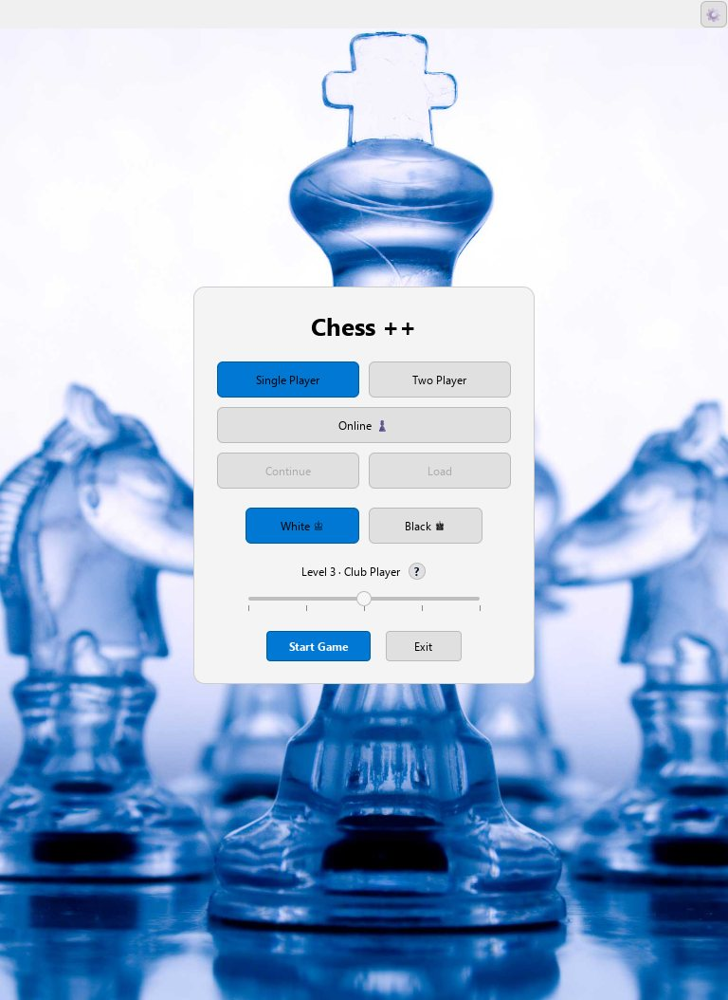
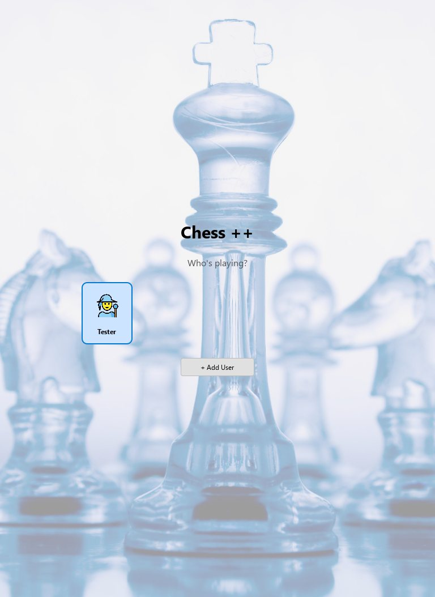
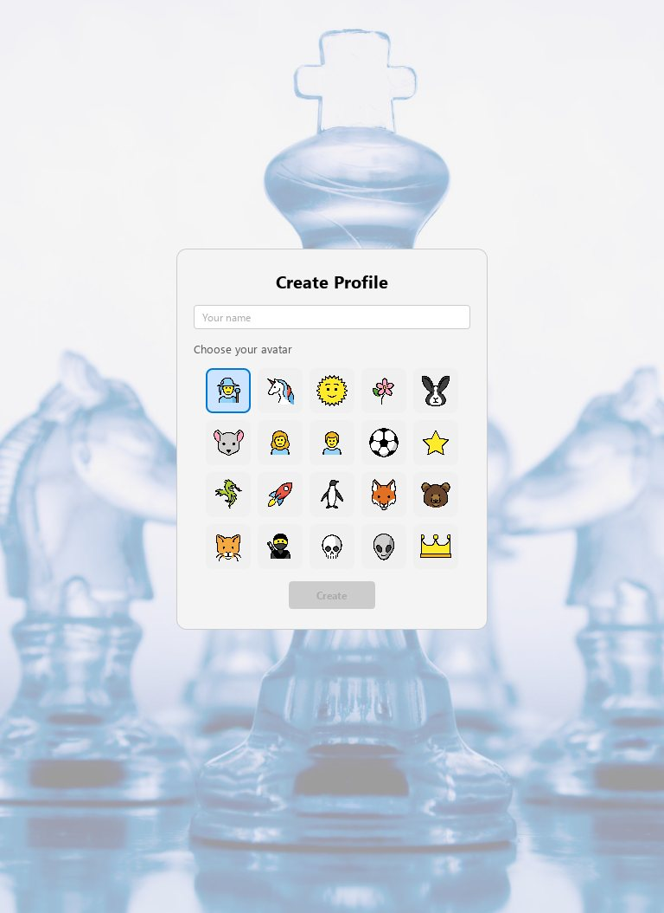
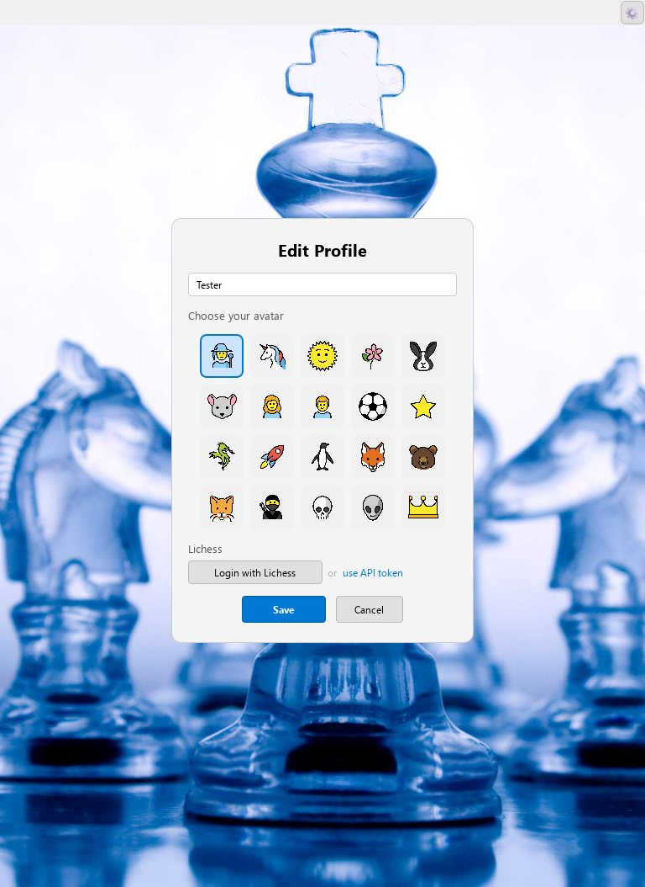
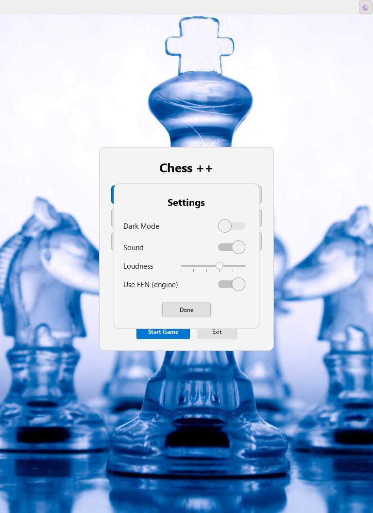
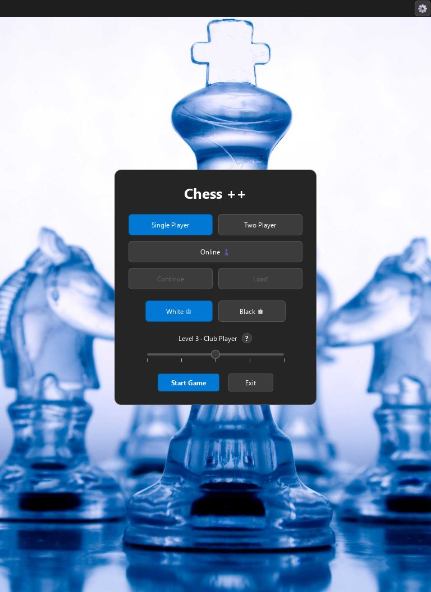
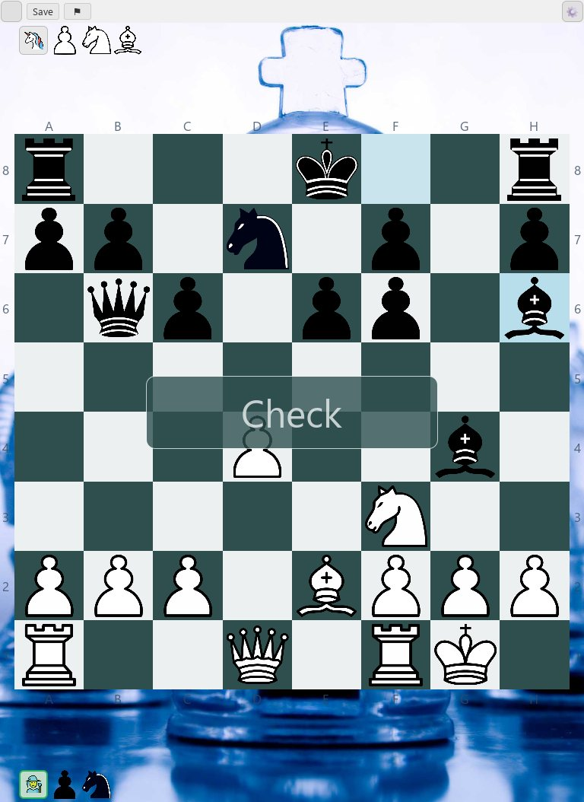
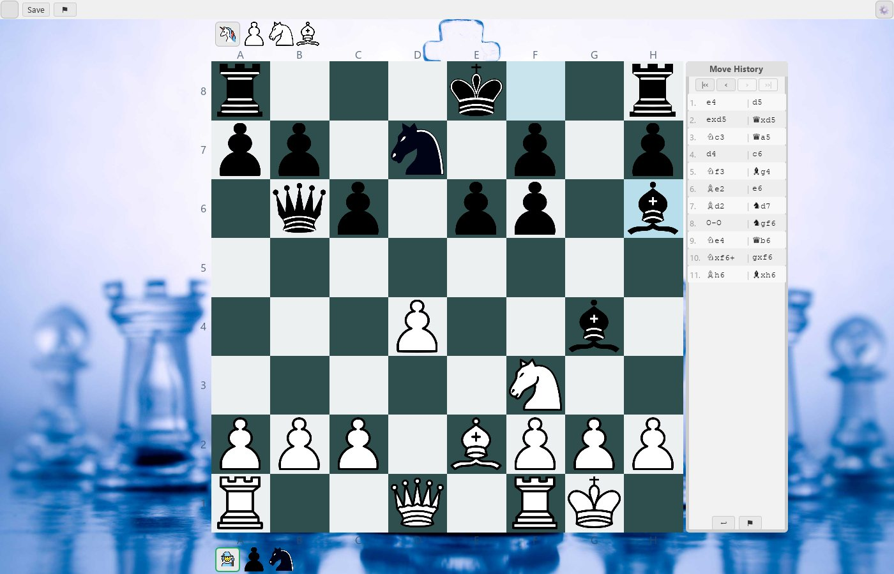
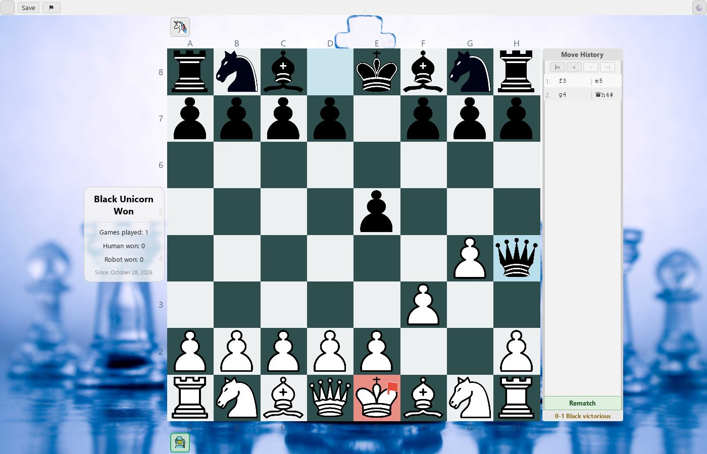
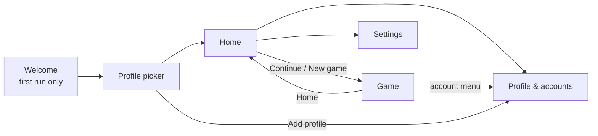

# App Modernisation — Review and Plan (BL-02, BL-03)

| | |
| :---- | :---- |
| **Date** | 2026-10-28 |
| **Status** | Plan approved; implementation in phases P1–P6 (§8), each on its own branch and PR |
| **Backlog** | BL-02 (screens), BL-03 (users and Lichess); also closes BL-01 and BL-08 |
| **Design kit** | Icons [`ChessGui/ChessGui/pics/icons/`](../ChessGui/ChessGui/pics/icons/), tokens [`design/ThemeTokens.md`](design/ThemeTokens.md), mockups (§10) |

## 1. Goal and scope

The goal is a Chess++ that looks and behaves like a **well-made Windows 11 app**, ready for
release and everyday use. That means clear user flows, consistent visuals, keyboard and
accessibility support, and safe handling of user data.

**In scope:** every screen around the game:
- start menu, login, profiles, settings, the Lichess dialogs, the toolbar;
- result display, move history, captured pieces;
- users and their data, with Lichess as a linked account (BL-03);
- backup.

**Out of scope:** how pieces are moved and dragged (BL-04), engine selection (BL-06, which only gets a
settings hook here) and new Lichess features such as chat and seeks (BL-07).

**Decisions:**

| Topic | Decision |
|---|---|
| User model | Keep **local profiles**. Lichess becomes an optional **linked account** per profile. |
| Look | **Windows 11 Fluent**: the `FluentWinUI3` Qt Quick Controls style (part of Qt 6.10), system light/dark and accent colour. The glass-pieces photo stays only as a faint Home backdrop. |
| Backup | Profile **export/import** plus automatic rolling backups and atomic saves. |

## 2. How the review was done

Every screen was captured with the screenshot mode:

```powershell
.\scripts\Take-Screenshot.ps1 -Scene all            # and -Dark, -Size 1400x900, -Moves "..."
```

Positions used:
- **Mid-game:** 11 moves of a Scandinavian Defence, with captures and a check.
- **Fool's mate**, to show the game end.
- **En passant:** `e2e4 a7a6 e4e5 d7d5 e5d6`.

The QML and C++ behind each screen were read in full. The "before" images below are in
[`design/before/`](design/before/).

| | | |
|---|---|---|
|  |  |  |
| Start menu | Login | Create profile |
|  |  |  |
| Edit profile + Lichess | Settings | Dark mode |
|  |  |  |
| Game, portrait (default window) | Game, landscape, history panel | Game end |

## 3. Findings

### 3.1 Architecture and consistency (affects every screen)

| # | Finding | Where |
|---|---|---|
| A1 | `ChessGame.qml` is 1199 lines. Navigation is faked with **12 `_show*` flags** plus `screen.state` values `screen_1`…`screen_4`. | `qml/ChessGame.qml` |
| A2 | Dialogs are plain `Rectangle`s toggled with `visible`. That means no modality or scrim, no Enter/Esc handling, no focus trap, and clicks reach the controls underneath. | all `*Dialog.qml` |
| A3 | Dark mode is worked out **16 times**, by reading the window colour's luminance (`Window.window.color`). Hex colours are hard-coded in every file. | all QML |
| A4 | The primary-button style is copy-pasted 5 times. There are two different `Button`s: `Button.qml` and an inline `component Button` in `ChessGame.qml`. | |
| A5 | `QQuickStyle::setStyle("Basic")` makes nothing look native and ignores the system theme. Dark mode recolours only the chrome; the photo stays bright. | `main.cpp` |
| A6 | Qt5Compat effects (`ColorOverlay`, `Glow`) are deprecated, and offscreen they render blank: the ☰ icon looks empty (BL-01). `NetworkPlayers.qml` is unused. | `ChessGame.qml`, `ChessFigures.qml` |
| A7 | `Notificator` is driven through `children[0]` and `resources[0]`. The board flip uses an elastic easing. | `ChessBoard.qml` |
| A8 | Missing for a release: an About page (version, Qt LGPL and Stockfish GPLv3 notices), a keyboard shortcut list, and confirmations before destructive actions. "Switch User" ends a running game silently; "Disconnect" has no confirmation. | |
| A9 | Game flows are put together in QML. When a Lichess game ends, QML maps the status to the result text and decides which king gets the red flag (`setGameResult`, `flagKing`). Starting an online game, starting a two-player game and Switch user are each a sequence of calls in QML. The services are untyped context properties. | `ChessGame.qml` (`onGameEnded`, `onGameStarted`, Switch User, `SelectPlayerDialog` handler), `main.cpp` |

### 3.2 Start menu
- Game types (Single / Two / Online) and actions (Continue / Load) share **one radio group**, so
  "Continue" looks like a mode.
- **Load** is disabled with no explanation.
- The level slider stays visible, only dimmed, for Two Player.
- There's an **Exit** button, which Windows apps don't have.
- The card floats over a busy photo, and there is no sign of who is logged in.

### 3.3 Toolbar
- The ☰ button looks empty (A6). Text ("Save") sits next to glyphs ("⚑", "↩").
- Undo and resign also exist in the history panel, so there are two places for the same action.
- The gear opens a popup that mixes Settings, Profile, Computer levels and Switch user.
- The window title is always "Chess ++" and never shows the mode or opponent.

### 3.4 Game screen layout
- **Portrait (the default 768×1054 window):**
  - The board sits off-centre and the left rank labels are clipped at the window edge.
  - The file letters below the board have almost no contrast against the photo.
- **Player identity:** the avatars are small tiles (about 38 px in the default window) in the corners, with no names; only the green
  pulse shows whose turn it is. Lichess opponents get no name or rating.
- **"Check"** appears as a large translucent box over the middle of the board, hiding pieces.
- **History panel:** it appears only when width > 1.15 × height and is a fixed 160 px. The default
  window never shows it.
- **Result:** it's shown in up to **three places**: the panel bar ("0-1 Black victorious"), the side
  card, and the portrait card.
  - It uses **avatar names** ("Black Unicorn Won").
  - The card shows "Human won / Robot won" statistics even in two-player games.

### 3.5 Move history (`MoveHistoryPanel.qml`)
- The moves are in Courier New, mixed with figurine glyphs from another font, so the
  columns don't line up. The highlight rectangles sit at hard-coded x = 29 / 101.
- The navigation buttons are text (`|<<`, `<`, `>`, `>>|`) at 12 px. Review mode shows
  "— reviewing —" in 9 px italic and makes the last button blink.
- You can't **click a move** to jump to it, there are no keyboard keys, and there is no way to
  copy or export PGN.
- The bottom of the panel repeats Undo and Resign (§3.3). Rematch is a green bar.

### 3.6 Captured pieces (`CapturedPanel.qml`, `ChessConnector::capturedByDark/Light`)
- Pieces are shown **in capture order**, not grouped, at **full piece size** (the panel height). With
  many captures the row grows past the board width; nothing wraps or shrinks.
- **No material balance** is shown. The mid-game example is +3 for Black (§2), but you have to count
  the pieces yourself.
- En passant was checked: it is counted correctly.

### 3.7 Users and profiles (`UserLoginScreen.qml`, `CreateUserDialog.qml`, `SelectPlayerDialog.qml`, `UserManager.cpp`)
- **Login:** the user cards are **left-aligned**. The `Flow` is full width, so a single card sits
  to the left; this happens in a real window too.
- **Profile management:**
  - You can't delete a profile.
  - You can't edit a profile from the login screen; you can only add one.
  - Nothing shows which profiles are linked to Lichess.
  - First run goes straight to "Create profile", with no welcome and no Lichess option.
- **Second-player picker:** it selects by `avatarName`, so two users with the same avatar can't be
  told apart. "Random" means a random avatar, not a random user. Only the logged-in user gets
  statistics.
- **Data safety:** `UserManager::save()` writes `users.json` with `QFile` + `Truncate`. A crash
  in the middle of a write leaves a broken file, and there are no backups. `config.json` works the
  same way.
- **Lichess token:** it's already protected with Windows DPAPI (`LichessClient::encryptToken`). That's
  good, but it means the token belongs to this Windows user and machine, so it can't go into an export.
- **Lichess login:** "Waiting for browser…" has no Cancel (BL-08). The token fallback field is a
  power-user feature shown to everyone.

### 3.8 Settings (`SettingsDialog.qml`)
- A small dialog with four rows: Dark Mode, Sound, Loudness, "Use FEN (engine)". The last is
  developer jargon.
- Sound on/off and the Loudness slider overlap; volume 0 also switches sound off.
- It has none of the sections a release needs: About, data, engine, gameplay options.

### 3.9 Lichess dialogs (`LichessGameDialog.qml`, `ChallengeDialog.qml`)
- A 418-line hand-styled form with custom-drawn combo, chip and button styles.
- The functionality is fine for now. BL-02 restyles and regroups it; new features belong to BL-07.

## 4. Target experience

### 4.1 Principles
1. **Native first.** FluentWinUI3 controls, system theme and accent, Segoe UI, Windows wording
   (sentence case, "Settings", no "Exit").
2. **One place per thing.** One result card, one Undo, one Settings page.
3. **Show who is playing.** Names, avatars, ratings and the turn are always visible.
4. **Nothing destructive without a confirmation.** Resign, delete profile, disconnect Lichess,
   switch user during a game.
5. **Keyboard and screen reader complete.** Every action has a focusable control with an
   `Accessible.name`; the common ones have shortcuts.

### 4.2 Navigation



- A `StackView` holds the pages. Settings and Profile are full pages, not pop-ups.
- Modal `Dialog`s are used only for short decisions: new-game setup, confirmations, promotion, the
  result, export/import.
- Notifications ("Game saved", "Check", errors) become a non-blocking **InfoBar** under the
  command bar, never an overlay on the board.

### 4.3 Screens

**Welcome (first run).** App logo, a one-line pitch, and two buttons: **Continue with Lichess**
(OAuth, creating a local profile pre-filled with the Lichess username) and **Create local profile**.
Small print explains that local profiles work offline and that Lichess can be linked later.

**Profile picker.** Centred cards with avatar, name, a Lichess badge and last played. Then "Add
profile", and "Manage" (opens Profile). It shows only when there are 2 or more profiles, or after
"Switch user".

**Home.**
- **Header:** the active profile (avatar, name, Lichess badge or rating) with an account menu:
  Profile, Switch user. Settings sits in the top right.
- **"Continue game"** card, shown only when there is an autosave: opponent, mode, move count,
  last played.
- **Action cards** (24 px icons from the kit): *Play vs computer*, *Two players*, *Play online*
  (dimmed with "Link your Lichess account" until linked), *Open saved game* (always enabled; it
  explains when there is nothing to open).
- Each card opens a **setup dialog** with only the options that apply:
  - vs computer: colour (White / Black / Random) and level, with the existing Levels help as an
    info button;
  - two players: who plays White and who plays Black (profiles or **Guest**);
  - online: the regrouped Lichess dialog.

**Game.**
- **Command bar** (a 40 px strip): Home ←, a title such as "vs Robot · Level 3" or
  "Alice vs Bob" or "Lichess · 5+3 · vs magnus", then icon buttons with tooltips: Undo
  (Takeback online), Flip board, Save, Offer draw (online), Resign, and "⋯" for More (Copy PGN,
  Export PGN, Levels help).
- **Player cards** above and below the board: avatar, **name**, rating (Lichess), a turn indicator
  (accent bar plus the pulse), the **captured strip** with "+N", and a clock slot for real-time
  Lichess games later.
- **Board:** fills the space between the player cards. Coordinates move **inside** the squares by
  default, so they never clip or fight the background; outside coordinates stay as an option.
- **Side panel**, shown when the window is wide enough (§ ThemeTokens 5): the move list on top,
  game actions and status at the bottom. In narrow windows it becomes a **bottom sheet**: a handle
  bar "12. Nf3 ▴" that expands.
- **Result:** a single **result card** over the board: "**Bob** wins by checkmate", "Draw by
  stalemate" or "**Alice** resigned", with the **real player names**. Buttons: Rematch, New game,
  Review moves. Statistics move to the Profile page.
- **Check** and the last move are shown on the board (red square tint, highlight), not as text.

**Move list.**
- Two columns, White and Black, with a move-number column.
- SAN is rendered with small **piece images** plus text in Segoe UI with tabular figures.
- **Click any move** to review that position. ←/→ go one ply, Home/End go to the start or end.
- In review, a slim InfoBar says "Viewing move 12 · **Back to live**", replacing the blinking button
  and "— reviewing —".
- **Copy PGN** and **Export PGN…**. A PGN includes headers (players, date, result) from the game record.

**Captured strip.**
- Captured pieces are **grouped by type** in value order P, N, B, R, Q.
- Pieces of the same type overlap (about 40%), drawn at about 55% of the card height, so a full
  set fits.
- **"+N" material advantage**, shown on the side that is ahead. It's computed from the pieces on
  the board in C++, so promotions count.

**Settings page** (Fluent settings cards, grouped):

| Group | Settings |
|---|---|
| Appearance | Theme: System / Light / Dark · Board coordinates: inside / outside · Reduce animations |
| Sound | Sound effects on/off · Volume (one control; muting is its own toggle) |
| Gameplay | Confirm before resigning · Show legal moves · Highlight last move |
| Computer | Engine: Stockfish (version) and a "Change…" hook for BL-06 · Computer levels explained |
| Data | Back up now · Restore from backup… · Export profile… · Import profile… · Open data folder |
| Advanced | Engine protocol: send position as FEN / as moves (today's "Use FEN") · Open log folder |
| About | Version, build, licences (Qt LGPLv3, Stockfish GPLv3 with a source link), GitHub link, keyboard shortcuts |

**Profile and accounts page.**
- **Identity:** name and avatar picker (the existing 20 avatars).
- **Lichess account card:**
  - *Not linked:* "Link Lichess account" (OAuth, with **Cancel** while waiting: BL-08) and
    "Use API token" behind an **Advanced** expander.
  - *Linked:* username, ratings for the main pool (blitz, rapid, classical, from `/api/account`),
    "Open profile on lichess.org", **Disconnect** (with confirmation).
  - *Token rejected (HTTP 401):* a caution InfoBar "Lichess sign-in expired · Reconnect".
- **Statistics:** games, wins/draws/losses against the computer per level and against people,
  since the creation date.
- **Danger zone:** Export profile…, Delete profile… (confirmation; you can't delete the active
  profile during a game).

## 5. Users and Lichess (BL-03)

### 5.1 Model
- A **profile** is local. It holds identity, avatar, statistics, autosave and saved game, and an
  optional Lichess link.
- **Linked Lichess account:** username and the DPAPI-encrypted token (as today), plus cached
  ratings and the time they were fetched. Ratings are refreshed in the background on login and after
  each online game.
- **Two players on one PC:** the two-player setup lets you pick a profile (by **id**, not avatar)
  or **Guest** for each colour. Statistics are recorded for each profile involved.

### 5.2 Flows
1. **First run:** Welcome → "Continue with Lichess" → browser → back in the app with a profile
   named after the Lichess user and a random avatar the user can change → Home.
   Or "Create local profile" → name and avatar → Home.
2. **Link later:** Profile → Link Lichess account. The **Cancel** button stops the local OAuth
   listener (BL-08).
3. **Expired token:** any Lichess call answering 401 marks the link "expired". Profile and Home show
   **Reconnect**, and online play is blocked until the user reconnects.
4. **Switch user during a game:** a confirmation; the game is autosaved for the current profile first.

### 5.3 Data safety and backup
- **Atomic writes:** `users.json` and `config.json` are written with `QSaveFile`, which writes a temp
  file and renames it.
- **Rolling backups:** on start, when `users.json` parses, copy it to `backups/users-1.json` and shift
  the older copies (keep 3). If `users.json` doesn't parse, offer **Restore from backup**.
- **Export profile:** one file, `<name>.chessprofile` (JSON). It holds the profile, statistics, and
  the autosave and saved game (embedded base64), with a format version. **It never includes the
  Lichess token**; the Lichess *username* is kept, so the import shows "Reconnect Lichess".
- **Import profile:** it's added as a new profile. If the id or name already exists, you get the
  choice of a new id with the name suffixed "(2)", or replacing the existing profile after a
  confirmation.

## 6. Architecture changes

| Change | Notes / existing code to reuse |
|---|---|
| Style → `FluentWinUI3` | `main.cpp`: `QQuickStyle::setStyle`. Remove the `background:` and `contentItem:` overrides that fight the style (A4). |
| `Theme.qml` singleton | Spec in [`design/ThemeTokens.md`](design/ThemeTokens.md). It replaces the 16 dark-mode copies (A3) and drives `Application.styleHints.colorScheme`. |
| Pages and components | Split `ChessGame.qml` (A1) into `WelcomePage`, `ProfilePickerPage`, `HomePage`, `GamePage`, `SettingsPage` and `ProfilePage`, plus `CommandBar`, `PlayerCard`, `CapturedStrip`, `MoveList`, `ResultCard`, `AppDialog`, `InfoBar` and `SettingsCard`. |
| Icons | `pics/icons/*.svg` into `qml.qrc`, used through `icon.source` and `icon.color`. This replaces `ColorOverlay` and the glyph labels. |
| Captured / material | `ChessConnector`: grouped captured counts plus a `MaterialBalance` property next to `capturedByDark/Light` (`chessconnector.cpp:341`). |
| Move list | Extend `moveHistory()` / `buildFullHistoryCache()` with the ply index and SAN pieces for the delegate. Add `reviewTo(ply)` next to `reviewFirst/Prev/Next/Last`, and `pgn()` (reuse `San.cpp`). |
| Users | `UserManager`: `deleteUser`, `users()` with Lichess fields, per-opponent statistics, `exportProfile` / `importProfile`, `QSaveFile`, backups. |
| Lichess | `LichessClient`: parse ratings from the existing `/api/account` call (`LichessClient.cpp:53`) and report a 401 as "expired". `LichessAuth`: `cancelLogin()` (BL-08). |
| QML ↔ C++ boundary (A9, **decided**, see CLAUDE.md "Key Conventions") | 1. Anything that reads or changes the game, including flows that combine it with users or Lichess, goes through `ChessConnector` as one call per user action. 2. `UserManager` and `LichessClient` stay separate services that QML calls directly for non-game work; their API is not forwarded through `ChessConnector`. 3. QML-visible services become typed singletons (`qmlRegisterSingletonInstance`) instead of context properties. |
| Game flows into C++ (P2) | New `ChessConnector` calls: `startLocalGame(whiteProfileId, blackProfileId)` (empty = Guest or Robot), `switchUser()` (autosave, end game, log out). The Lichess game start and end (`LichessClient::gameStarted` / `gameEnded`) are handled inside `ChessConnector`: result text, flagged king, opponent avatar. QML only shows the resulting state. |
| Singletons (P2) | `main.cpp`: `qmlRegisterSingletonInstance("ChessPlusPlus", 1, 0, "ChessConnector", connector)` and the same for `UserManager`, `LichessClient`, `AvatarProvider`. QML imports `ChessPlusPlus` and uses `UserManager.login(…)` with type information for qmllint and the IDE. All about 156 references (`chessConnector.` 101, `userManager.` 39, `lichessClient.` 9, `avatarProvider.` 7) are renamed in P2, together with the page split. Plain `Connections { target: … }` blocks keep working. |
| Screenshot scenes | `setUpScreenshotScene()` in `ChessGame.qml` uses the `_show*` flags. Each phase keeps the existing scenes working and adds new ones (`welcome`, `home`, `profiles`, `review`, `result`). |

## 7. Windows app checklist (applies to every phase)

- [ ] Sentence-case labels; verbs on buttons ("Create profile", not "OK").
- [ ] Every icon-only button has a tooltip and an `Accessible.name`.
- [ ] Tab order is correct. Enter is the default action and Esc cancels or closes in every dialog.
- [ ] Shortcuts:
  - Ctrl+N new game, Ctrl+S save, Ctrl+O open, Ctrl+Z undo;
  - ←/→/Home/End move review, F flip board;
  - F1 help (computer levels), Ctrl+, settings.
- [ ] System theme, accent colour, high contrast mode, 100–200% scaling (SVG icons only).
- [ ] Minimum window size; the window title shows the state ("Chess++ — Alice vs Bob").
- [ ] Confirmation before destructive actions. No Exit button; closing the window autosaves.
- [x] The About page has the version and licences (Qt LGPLv3, Stockfish GPLv3 with a source link). Done in P5.

## 8. Roadmap

Each phase gets its own branch from `develop` and its own PR, with before/after screenshots
(`Take-Screenshot.ps1`) in the PR description.

| Phase | Content | Done when |
|---|---|---|
| **P1 Foundation** ✅ | FluentWinUI3 · `Theme.qml` · System/Light/Dark · icons in `qml.qrc` · `AppDialog` (modal, scrim, Enter/Esc) · remove Qt5Compat effects and `NetworkPlayers.qml` (**closes BL-01**) | All existing screens render in Fluent light and dark; no `Window.window.color` left; screenshot scenes pass. Done: branch `fluentFoundation_281026`, after shots in [`design/after-p1/`](design/after-p1/) |
| **P2 Shell and navigation** ✅ | `StackView` pages · command bar · account menu · Home with Continue and action cards · setup dialogs · InfoBar replaces `Notificator` · `_show*` flags removed · services as typed singletons · game flows moved into `ChessConnector` (`startLocalGame`, `switchUser`, Lichess game start/end) | Every action of today's menu and toolbar is reachable; no game-step sequences left in QML; no `setContextProperty` left; scenes `home` and `game` added. Done: branch `shellNavigation_291026`, after shots in [`design/after-p2/`](design/after-p2/); notes in `PROGRESS.md` (2026-10-29) |
| **P3 Users and Lichess** ✅ (**BL-03**, **BL-08**) | Welcome · profile picker · Profile page (Lichess card, ratings, 401 Reconnect, OAuth Cancel) · two-player setup by profile id and Guest · statistics per opponent · `QSaveFile`, backups, export/import | Unit tests for `UserManager` export/import, backup rotation and corrupt-file recovery (`ChessQtTests`). Done: branch `usersLichess_291026`, after shots in [`design/after-p3/`](design/after-p3/); notes in `PROGRESS.md` (2026-10-29) |
| **P4 Game chrome** ✅ | Player cards · captured strip with +N · responsive side panel or bottom sheet · single result card · new move list (click, keys, Copy/Export PGN) | Unit tests for material balance and PGN; screenshots portrait, landscape, review, result. Done: branch `gameChrome_291026`, after shots (dark) in [`design/after-p4/`](design/after-p4/); notes in `PROGRESS.md` (2026-10-29) |
| **P5 Settings and About** ✅ | Settings page groups (§4.3) · About and licences · shortcut list | Every old setting has migrated (`config.json`, QML `Settings`). Done: branch `settingsAbout_291026`, after shots in [`design/after-p5/`](design/after-p5/); notes in `PROGRESS.md` (2026-10-29) |
| **P6 Polish** | Keyboard and accessibility pass · high contrast · motion tokens · app icon and installer visuals · screenshot baselines for all scenes (with BL-05) | Checklist §7 all ticked |

**Ordering:** P1 comes first because everything builds on it. P2 comes before P3 and P4, which can
run in parallel after P2. P5 and P6 come last.

## 9. Open questions

1. ~~**QML access rule (A9)**~~ **Decided 2026-10-28.** The three-point rule is in CLAUDE.md and §6. Game flows go through `ChessConnector`, services stay separate typed singletons, and nothing is forwarded.
2. ~~**Guest games**~~ **Decided in P3:** they count for the profile that played, with the opponent shown as "Guest".
3. **Board themes:** a picker for board and piece themes was left out of this plan, to stay native and simple. Revisit after P6.
4. **Real-time Lichess clocks:** the player card reserves the space. Showing the clocks belongs to BL-07.

## 10. Design kit

- **Icons:** [`ChessGui/ChessGui/pics/icons/`](../ChessGui/ChessGui/pics/icons/), 38 original monochrome SVGs.
  - They're drawn on a 20×20 grid with 1.5 px round strokes.
  - They use only `g`, `path`, `circle` and `rect`, so Qt SVG renders them (checked offscreen with the FluentWinUI3 style, light and dark).
  - Tint them with `icon.color`. They're not in `qml.qrc` until P1.
  - Names: `back`, `clock`, `close`, `copy`, `delete`, `draw`, `edit`, `export`, `first`, `flag`, `flip-board`, `folder-open`, `globe`, `home`, `import`, `info`, `keyboard`, `last`, `link`, `menu`, `more`, `next`, `people`, `person`, `person-add`, `play`, `prev`, `rematch`, `robot`, `save`, `settings`, `sign-out`, `theme`, `trophy`, `two-players`, `undo`, `volume`, `volume-mute`.
- **Theme tokens:** [`design/ThemeTokens.md`](design/ThemeTokens.md).
- **Mockups:** [Chess++ Fluent mockups](https://claude.ai/artifact/RcsCJ2qzRo3T5qaKxjJtb7), a private design canvas that has to be shared before others can open it.
  - Artboards: Welcome, Profile picker, Home, Game (landscape, dark, mid-game with +3 material), Game (portrait, result card and moves sheet), Dialogs (new game, export, import conflict), Settings, Profile and accounts (linked, waiting with Cancel, expired), Design kit.
  - Each artboard has a **dark** tweak.
  - They use the app's real piece images and avatars; the names and numbers in them are sample data.
